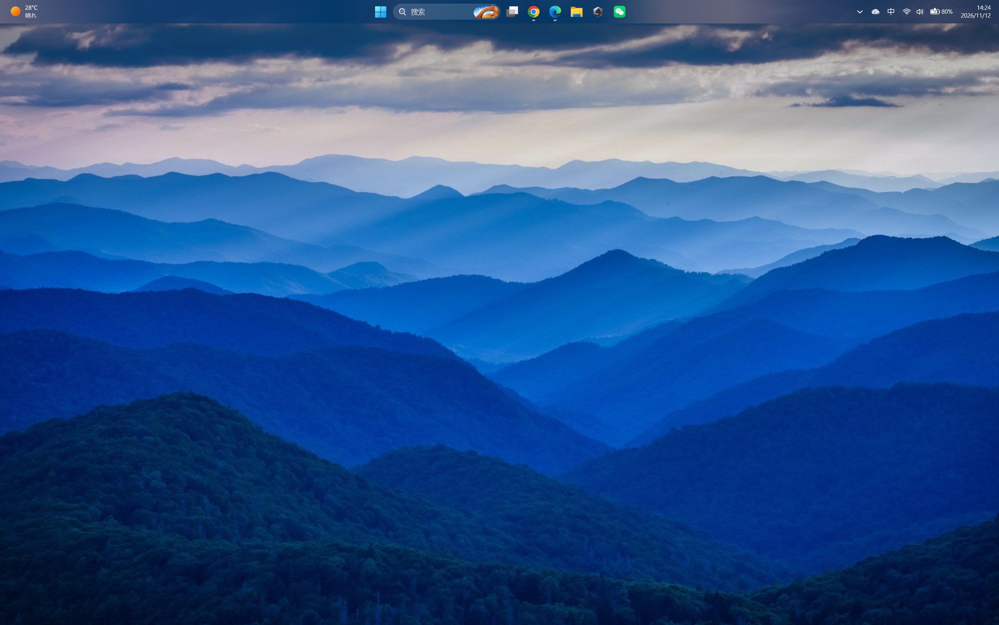
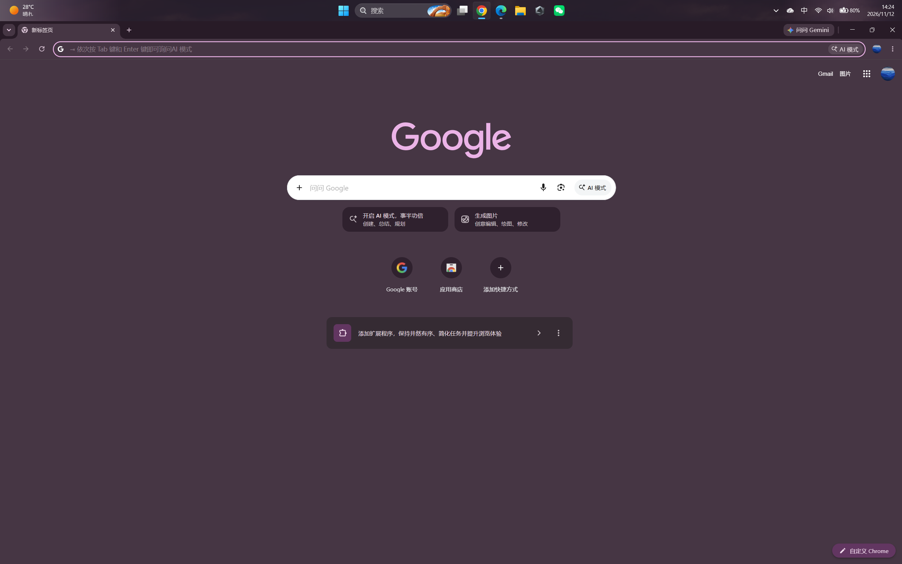
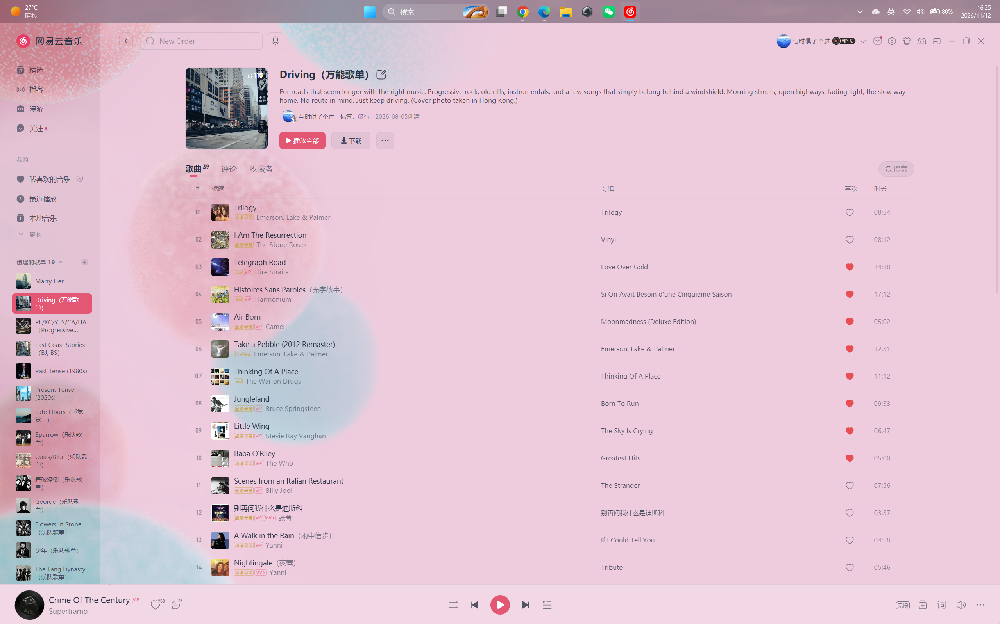
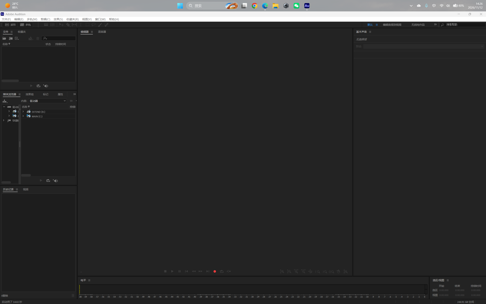

# TranslucentTB Dynamic

[简体中文](README.zh-CN.md)

An experimental community modification of [TranslucentTB](https://github.com/TranslucentTB/TranslucentTB): let the taskbar follow nearby screen colours as a horizontal gradient, with an integrated toggle and parameter panel.

**2026.2.5-rc1 · Windows 11 x64 · unofficial, unsigned preview.** This is a local release candidate prepared for review. It is not an upstream release or an accepted pull request.

## What it does

- Splits the taskbar into configurable colour zones, with filtered, smooth transitions.
- Adds **Dynamic tint** and a parameter page to the existing XAML tray menu. Turning it off returns to the original appearance rules.
- Offers **Adaptive** sampling (input/window hints, bounded startup retries and a low-rate fallback) and **Continuous** sampling.
- Preserves thumbnail-hover protection while allowing taskbar clicks and foreground changes to refresh the selected application's colour.
- Includes fixes for delayed application startup, exit restoration and a brief transparent fallback when returning to the desktop.

It does **not** automatically recolour taskbar text or icons. Readability on different backgrounds still needs broader testing.

## Screenshots

These user-provided screenshots show taskbar colours with different screen content on the same computer. The taskbar is at the top of the screen.

### Mountain desktop

A blue-grey taskbar gradient alongside the mountain wallpaper.

### Chrome dark interface

With Chrome in the foreground, the taskbar takes on dark purple tones similar to the browser interface.

### NetEase Cloud Music light interface

The pink interface is accompanied by a pink-grey taskbar gradient, with visible colour differences across its width.

### Adobe Audition workspace

The taskbar above the Audition workspace appears grey, showing the colours in another application context.

These still images illustrate appearance. Animated transitions and refresh timing need to be experienced in use.

## Install and use

Download the x64 installer and matching source ZIP from this repository's Releases when published. See [release notes and installation](docs/RELEASE.md).

1. Exit the running TranslucentTB instance and other taskbar appearance utilities.
2. Run the community installer. It includes the original application, this feature and its dependencies.
3. Open the tray menu → dynamic tint parameters. Choose Adaptive or Continuous and click Apply.

The installer preserves existing settings. A fresh installation enables dynamic tint in Adaptive mode, with 10 zones, 120 rendering FPS and a requested sampling limit of 30/sec. The **source configuration defaults to disabled**.

| Setting | Range |
|---|---|
| Colour zones | 1–32; 1 uses a single colour |
| Rendering FPS | 20–120 |
| Requested sampling rate | 1–60/sec |
| Sampling depth | 0–4096 pixels; 0 is automatic |
| Sampling method | Adaptive / Continuous |

A depth of **0 means automatic**: before each capture the depth is recomputed from the taskbar and monitor geometry — **1/50** of the available distance on the nearer side of the bar (rounded, minimum 2 pixels) — and sampling starts **10 pixels** beyond the bar's edge. It is not "stop sampling", and no previous value is reused. A specific pixel value fixes the depth while keeping the direction, gap and clipping rules. [Automatic sampling depth](#automatic-sampling-depth) has the formula and a worked example.

Requested rates are limits, not achieved-frame guarantees. Hover protection can temporarily postpone capture. [Mechanism and configuration](docs/DESIGN.md) explain the distinction between capture and rendering.

## Defaults and sampling policy

### Automatic sampling depth

Automatic depth uses taskbar and monitor geometry to select a narrow adjacent band. For a horizontal top/bottom taskbar, depth is **1/50 (about 2%)** of the available distance towards the monitor interior, rounded to the nearest pixel with a minimum of 2 pixels. For an edge-aligned bar, that distance normally equals monitor height minus taskbar height.

The band starts **10 pixels** beyond the taskbar edge to skip its border/shadow, extends downwards for a top bar or upwards for a bottom bar, and is clipped to its monitor. On a 1600-pixel-high screen with a 60-pixel-high top bar, automatic depth is approximately `round((1600 - 60) / 50) = 31` pixels, starting 10 pixels below the bar's lower edge. Manual depth replaces the computed depth while retaining the direction, gap and clipping. This calculation does not identify application content or choose a region semantically.

With multiple zones, the band is downsampled to **8 columns per zone and 12 rows**: 20 zones use a 160 × 12 sampling bitmap. Per-zone processing includes bright-row rejection and colour weighting rather than averaging the entire screen.

### Adaptive scheduling

These are the ordinary scheduling rules at the default 30/sec limit with legacy `sample_interval` set to 0. Lower requested limits can lengthen these intervals.

| State or trigger | Scheduling rule |
|---|---|
| No initial sample | Sampling is immediately eligible |
| Stable, no new activity | Approximately every 500 ms (2/sec fallback) |
| Input activity hint | Scheduled about 100 ms later; ordinary event captures are spaced at least about 80 ms apart. Hints coalesce without indefinitely postponing an existing deadline |
| Detected colour change | Approximately every 50 ms (20/sec) during the active period; each change extends it to 1000 ms after that sample |
| Three consecutive unchanged samples | Ends the active period early |
| Foreground window change | Restarts retries at approximately 120, 300, 800, 1600, 3200 and 6000 ms relative to the change |

Change detection compares sampled colour differences with the deadband, set to 3 in the installer configuration. These are scheduling targets, subject to message handling, capture time and hover protection. Retries can merge with other captures rather than producing a separate capture at every listed time.

Ordinary thumbnail-hover protection pauses capture, transitions and gradient submissions. Dismissal normally has a roughly 250 ms grace period; the application-selection fast-resume path uses about 80 ms. When the foreground changes while the pointer remains on the bar, a dedicated refresh becomes eligible after about 250 ms and can bypass ordinary capture-due checks. The configured sampling rate is therefore an ordinary scheduling limit, not a strict count guarantee across all interaction paths.

Continuous mode requests captures at the configured interval (about 33 ms using integer intervals at 30/sec), still subject to protection and runtime conditions. Adaptive capture rates below the configured limit are expected. A 120 FPS rendering setting does not mean 120 screen captures per second.

Implementation: [capture band and zones](src/TranslucentTB/taskbar/dynamictint.cpp), [adaptive scheduler](src/Common/util/dynamictintschedule.hpp), [taskbar interactions](src/TranslucentTB/taskbar/taskbarattributeworker.cpp). One old configuration-header comment still says 1/pi; the actual automatic-depth calculation uses **1/50**, as documented above.

## Measured CPU cost

On one i9-13980HX machine with 32 logical processors and two displays, a script restored/minimized the same application through its taskbar icon every four seconds, leaving the pointer on the icon. Each mode had two 48-second measurement windows after settling.

| Mode | Mean TTB main-process CPU |
|---|---:|
| Dynamic tint off | 0.0020% |
| Adaptive | 0.0137% |
| Continuous | 0.0381% |

Percentages use total logical-processor time capacity as 100%, without frequency weighting. In **this workload**, Adaptive used about 64% less main-process CPU time than Continuous. This is not a whole-machine CPU reduction, a universal result or a battery-life claim. Explorer also hosts part of the taskbar work. Whole-machine battery telemetry did not establish attributable power savings. [Method, raw exported measurements and limitations](docs/PERFORMANCE.md).

## Status and known issues

The matching application build passed 96 automated tests, including capture-buffer reuse and GDI-resource checks. The user reported that the desktop-switch hotfix basically passed their WeChat scenario. This is not comprehensive validation of all taskbar/display combinations.

HDR, protected content, special desktops and third-party taskbar combinations need further testing. Read [testing and known issues](docs/TESTING.md) before evaluating the preview.

## Build, review and attribution

The application source is under `src/`, based on upstream 2026.2 commit `d4636e439865df0a1a1419db408e055740ce5c74`. See [build instructions](docs/BUILD.md), [maintainer notes](docs/UPSTREAM.md), [modification record](MODIFICATIONS.md) and the verified alternative patches under `patches/`. Every file and folder is described in the [file guide](FILES.md).

Original application copyright, icon credits and third-party notices are retained. Application code is distributed under the upstream GPLv3 licence: [LICENSE.md](LICENSE.md). Microsoft runtime components retain their own licences. This modification was developed with AI coding assistance and user testing; independent code review is welcome.
