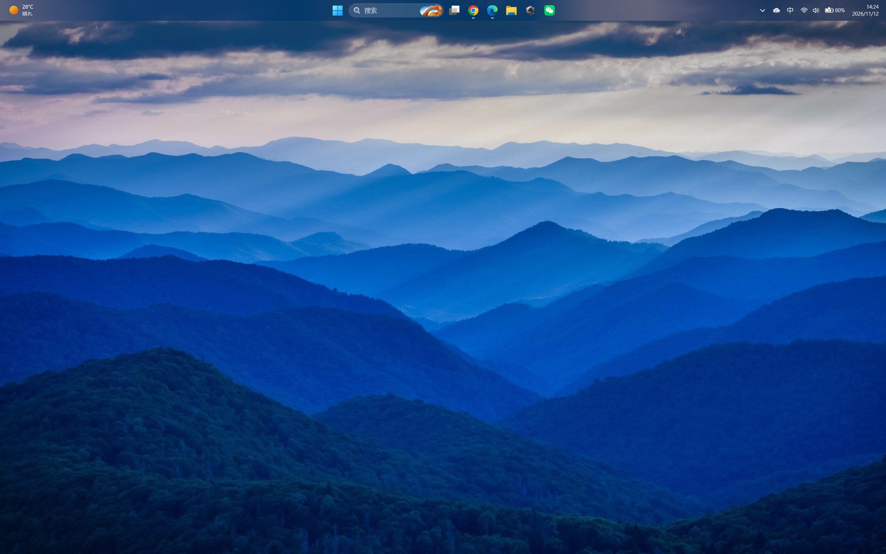
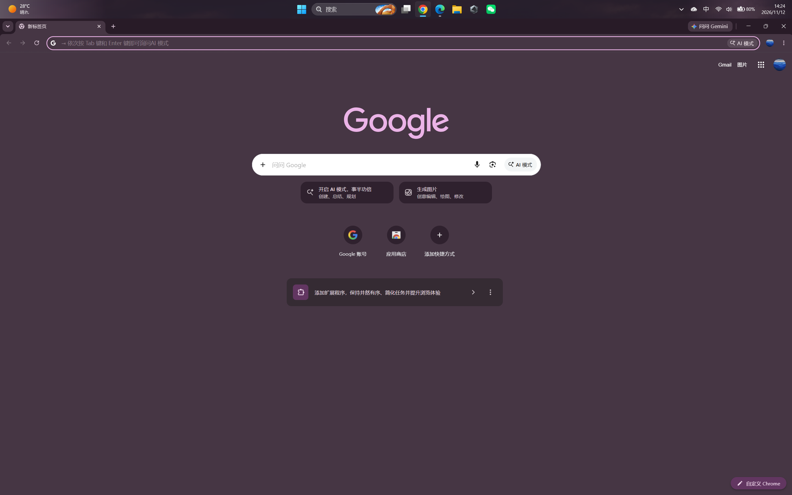
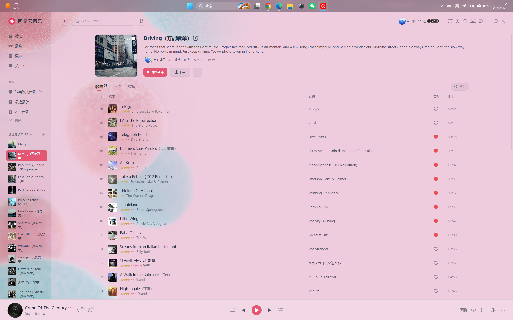
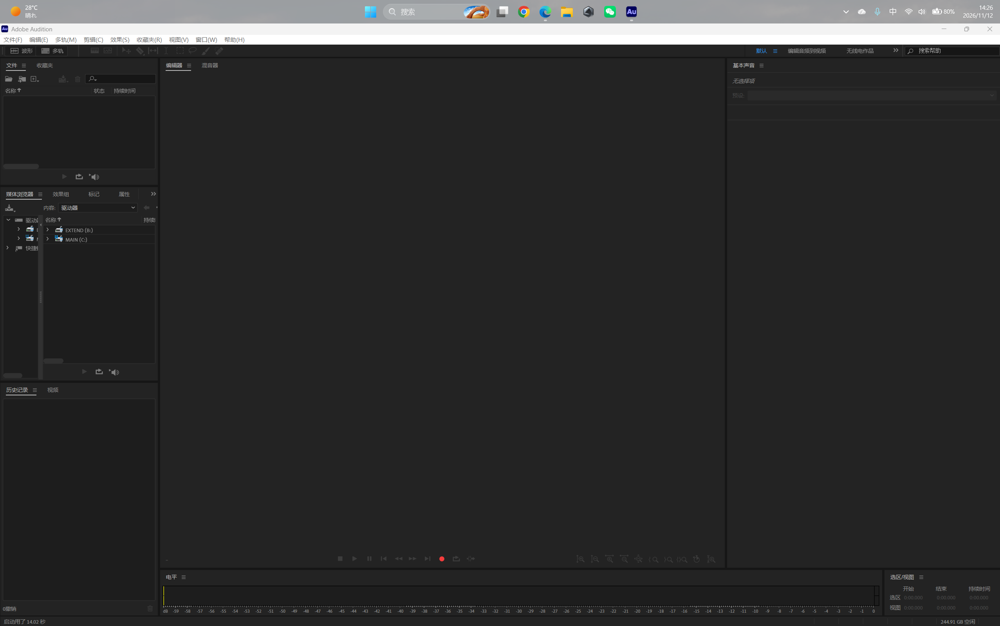

# TranslucentTB Dynamic

[English](README.md)

基于 [TranslucentTB](https://github.com/TranslucentTB/TranslucentTB) 的实验性修改版：让任务栏跟随附近屏幕内容，呈现横向分区渐变；开关和参数面板直接放在原有托盘菜单里。

**2026.2.5-rc1，Windows 11 x64，非官方、未签名的开发预览版。** 当前是供审阅的本地发布候选，不代表原作者已经接受或认可。

## 功能

- 任务栏横向分区取色，经过过滤和平滑过渡后显示渐变。
- 原菜单新增“动态取色”和参数面板；关闭后恢复原软件的外观规则。
- 提供自适应、连续两种采样方式。自适应结合输入和窗口事件、启动重试及低频兜底。
- 保留缩略图悬停保护，同时允许点击任务栏、切换前台窗口后刷新颜色。
- 包含慢启动应用补刷新、退出恢复，以及回桌面瞬间退回透明状态的修复。

本版没有自动调整任务栏文字、图标颜色，不同背景下的可读性仍需扩大验证。

## 效果预览

以下截图由用户在同一台电脑上实拍，展示不同屏幕内容下的任务栏配色。截图中的任务栏位于屏幕顶部。

### 山景桌面

任务栏呈现随山景壁纸变化的蓝灰色渐变。

### Chrome 深色界面

切换到 Chrome 后，任务栏呈现与浏览器深色界面相近的暗紫色调。

### 网易云音乐浅色界面

粉色界面下，任务栏呈现粉灰色渐变，可以观察到横向不同区域的颜色差异。

### Adobe Audition 工作区

Audition 工作区上方，任务栏呈现灰色调，展示另一种应用界面下的配色。

这些静态截图用于展示外观；动态过渡效果和刷新速度需在实际使用中体验。

## 安装与使用

公开发布后，在本仓库 Releases 下载安装 EXE 和配套源码 ZIP。[安装、升级和回退说明](docs/RELEASE.md)。

1. 先退出正在运行的 TranslucentTB 及其他任务栏外观工具。
2. 运行安装器，安装完整原软件与新增功能。
3. 右键托盘图标 → 动态取色参数 → 选择采样方式，点击“应用”。

覆盖安装保留已有配置。全新安装默认开启动态取色、自适应模式、10 段、120 FPS、采样上限 30 次/秒；**源码中的功能默认关闭**。

| 参数 | 范围 |
|---|---|
| 任务栏分区 | 1–32 段；1 为单色 |
| 渲染帧率 | 20–120 FPS |
| 采样频率上限 | 1–60 次/秒 |
| 采样深度 | 0–4096 像素，0 为自动 |
| 采样方式 | 自适应 / 连续 |

采样深度填 **0 就是自动**：程序每次取色前按任务栏和显示器的几何关系现算深度，取"任务栏边缘到屏幕内侧面更近那一侧"可用距离的 **1/50**（四舍五入，最少 2 像素），并从紧邻任务栏边缘的 **10 像素**之后开始取色；不是停止取色，也不沿用上次的值。填具体像素时固定该深度，方向、间隔和裁切规则不变。[自动采样深度怎么算](#自动采样深度怎么算) 有完整公式和例子。

采样频率不等于显示帧率，设置值也不保证实际达到。悬停保护可能暂缓取色。[原理与配置](docs/DESIGN.md) 中有具体说明。

## 默认参数与采样规则

### 自动采样深度怎么算

“自动”按任务栏所在显示器的几何尺寸计算一条邻近取色带。对于顶部或底部的横向任务栏，取色带深度为朝向屏幕内部一侧可用距离的 **1/50（约 2%）**，四舍五入且最少为 2 像素。贴边任务栏的该距离通常就是屏幕高度减去任务栏高度。

取色区域先避开任务栏边缘 **10 像素**的边框/阴影间隔，再向屏幕内部延伸计算出的深度：顶部任务栏向下取色，底部任务栏向上取色，并裁切到所在显示器边界。以高 1600 像素的屏幕、60 像素高的顶部任务栏为例，自动深度约为 `round((1600 - 60) / 50) = 31` 像素，区域从任务栏下边缘再向下 10 像素处开始。

手动深度按相同方向和间隔确定取色带，以指定像素深度替代自动值。自动深度随显示器和任务栏尺寸计算，不分析应用语义，也不按窗口内容寻找取色区域。

多分区模式将取色带缩采样为 **分区数 × 8 列、12 行**的小位图；20 段对应 160 × 12 个采样像素，再分别计算各区颜色。取色还包含亮度异常行过滤及颜色加权，不是直接对整张屏幕求平均。

### 自适应模式的调度时间

下表为默认采样上限 30 次/秒、旧式 `sample_interval` 为 0 时的普通调度规则。设置更低的采样上限时，相应间隔会受到该上限约束。

| 状态或触发 | 调度规则 |
|---|---|
| 尚未取得首个样本 | 立即允许采样 |
| 稳定、无新活动 | 每约 500 ms 一次，约 2 次/秒兜底 |
| 鼠标/键盘等活动提示 | 提示安排在约 100 ms 后；普通事件采样距上次采样至少约 80 ms。密集事件合并，后续提示不会无限推迟已有提示 |
| 检测到颜色变化 | 在活跃期内每约 50 ms 一次，约 20 次/秒；每次变化将活跃期延长到其后 1000 ms |
| 连续 3 次采样未检测到变化 | 提前结束活跃期，回到低频调度 |
| 前台窗口切换 | 重启补采样计划：相对切换时刻约 120、300、800、1600、3200、6000 ms，照顾延迟绘制的窗口 |

这里的“颜色变化”由采样颜色差异与死区阈值比较判断；安装配置的 `deadband` 为 3。以上时间是调度目标，实际采样还受消息处理、采样耗时及悬停保护影响。补采样时点可能与其他采样合并，不保证每个时点各执行一次。

普通缩略图悬停保护会暂停采样、颜色过渡和渐变提交；离开后通常等待约 250 ms 的关闭动画宽限，应用选择的快速恢复路径使用约 80 ms。前台已切换、鼠标仍停在任务栏时，另有约 250 ms 后的专用刷新通道，可绕过普通采样到期判断。因此采样频率设置是普通调度的请求上限，并非对所有交互路径的严格计数承诺。

连续模式按设置的采样间隔持续请求采样（30 次/秒设置对应整数间隔约 33 ms），仍受上述保护和实际运行条件影响。自适应模式通常达不到设置上限，这是降低重复采样的预期行为；120 FPS 渲染也不意味着每秒截屏 120 次。

实现位置：[取色带与分区采样](src/TranslucentTB/taskbar/dynamictint.cpp)、[自适应调度](src/Common/util/dynamictintschedule.hpp)、[任务栏交互与刷新](src/TranslucentTB/taskbar/taskbarattributeworker.cpp)。当前配置头文件仍有一处旧注释将自动深度写为 1/π；实际计算使用上文所述的 **1/50**。

## 实测 CPU 开销

在一台 i9-13980HX、32 逻辑处理器、双屏电脑上，脚本每 4 秒点击同一应用的任务栏图标，交替恢复和最小化，鼠标保持在图标上。各状态测两轮，每轮稳定后记录 48 秒。

| 状态 | TTB 主进程平均 CPU |
|---|---:|
| 关闭动态取色 | 0.0020% |
| 自适应 | 0.0137% |
| 连续 | 0.0381% |

占用率以全机逻辑处理器总时间容量为 100%，没有按实时频率加权。**在本次切换场景中，自适应的主进程 CPU 时间比连续减少约 64%。** 这不是整机 CPU 降幅，也不代表所有使用场景，更不能写成省电比例；部分任务栏工作位于 Explorer 中。整机放电遥测未得到可归因于软件的省电结论。[完整报告、数据与局限](docs/PERFORMANCE.zh-CN.md)。

## 验证范围与已知问题

对应程序通过了 96 项自动测试，包括采样位图复用和 GDI 资源检查。用户反馈微信关闭回桌面的热修场景“基本上通过”；不代表所有多屏、桌面和缩略图组合均已验证。

HDR、受保护内容、特殊桌面及第三方任务栏组合仍需扩大验证。详见[测试与已知问题](docs/TESTING.md)。

## 源码、构建与署名

`src/` 保留完整应用源码，基于上游 2026.2 提交 `d4636e439865df0a1a1419db408e055740ce5c74`。提供[构建说明](docs/BUILD.md)、[给维护者的说明](docs/UPSTREAM.md)、[修改记录](MODIFICATIONS.md) 和可独立选择的补丁。每个文件和目录的用途见[文件说明](FILES.md)。

保留原软件作者、图标和第三方署名，应用源码沿用上游 GPLv3 许可证，见 [LICENSE.md](LICENSE.md)。微软运行时使用各自许可证。本修改版借助 AI 编程工具开发，并结合用户实测修正，欢迎独立审查。
